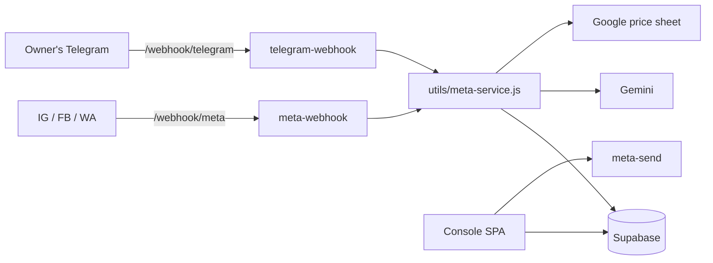

# Clinix360 Dashboard

The DSkin clinic console: daily cashup, a shared Instagram, Facebook and WhatsApp lead inbox, and an Instagram DM chatbot. The owner gets the chatbot's alerts and price questions on Telegram.

Static SPA (`index.html` + `app.js` + `styles.css`, no build step) on Netlify, with Netlify Functions and Supabase (Postgres + Auth + Realtime).

---

## 🚨 Deploy target: do not confuse this app with the marketing site

This app deploys only to its own Netlify site:

| Project | Netlify site ID | Site |
|---------|-----------------|------|
| **This app** | `eabc30b1-b8d9-4d57-978f-c37ab643f35e` | dskin-cashup → cashup.dskin.co |
| Derma marketing site (different repo) | `2645c785-a8d5-4e06-b72b-aedf1fedca47` | cosmic-cascaron-69cab5 |

Never deploy the marketing site to this app's site ID. That replaces the live console and locks staff out (this happened on 6–7 June 2026).

```bash
NETLIFY_AUTH_TOKEN=<token> npx netlify-cli@22 deploy --prod --dir . --site eabc30b1-b8d9-4d57-978f-c37ab643f35e
```

The working token is in `.netlify-token.env`, which is not tracked. Netlify build credits are limited, so check the remaining credits before each deploy.

---

## Quick start (local)

```bash
npm install
cp .env.example .env          # fill in at least SUPABASE_* (see Configuration)
npx netlify-cli@22 dev        # serves the SPA + functions on http://localhost:8888
```

Run the tests (no framework, no env vars):

```bash
node netlify/functions/utils/meta-service.test.js
```

---

## Features

**Console (sign-in with a Supabase Auth email + password)**
- **Overview**: branches and performance at a glance
- **Cashup**: daily sales entries, summary, extra cash and expenses per branch, with variance email alerts
- **Leads**: one realtime inbox for IG, FB and WA, with staff replies, category chips and a handoff summary card
- **Reports**: filter by date range and branch
- **Settings**: connected accounts, automations, comment automation, chatbot, Teach the Bot, payment modes

**Chatbot (Instagram DMs, Gemini)**
- Modes: `off` · `shadow` (drafts only, plus a daily Telegram digest) · `live` (sends replies)
- Answers from the KB and from the client's Google price sheet. It quotes Customer Price as written and never multiplies prices.
- Hands a chat to staff (staff auto-takeover); an emergency or a KB miss emails an alert
- Comment automation: keyword rules on IG and FB posts send a private-reply DM with the post's offer
- Pushes settled chats to a Make webhook as `lead` / `potential_lead`

**Owner on Telegram**
- Price-question alerts. The owner's answer goes to the customer and to the sheet's *Bot answers* tab, with a Don't-save undo.
- `/mode` switches the bot mode; `/prices` syncs the price sheet now
- Daily or weekly bot report; a 2 h reminder, then a 20 h fallback on unanswered questions

---

## Configuration

All secrets are Netlify environment variables (copy [.env.example](.env.example) for local dev, which has where-to-find-it notes for each one).

| Variable | Needed for |
|----------|------------|
| `SUPABASE_URL`, `SUPABASE_ANON_KEY` | Browser sign-in (served by `get-config`; the anon key reads no table) |
| `SUPABASE_SERVICE_ROLE_KEY` | Every function and script. Server-only, never ship it to the browser. |
| `RESEND_API_KEY` | All email (variance, feedback, reports, fallback alerts) |
| `META_APP_ID`, `META_APP_SECRET`, `META_VERIFY_TOKEN` | Meta webhook verification + HMAC signature check |
| `META_ACCESS_TOKEN`, `META_IG_ID` | Instagram fallback token (the connected token in `secrets` wins) |
| `IG_APP_ID`, `IG_APP_SECRET`, `IG_CONNECT_CODE` | The Connect Instagram link (if `IG_CONNECT_CODE` is unset, the link is disabled) |
| `META_PAGE_ACCESS_TOKEN`, `META_PAGE_ID` | Facebook Messenger + FB comment replies |
| `META_BRANCH_ID` | Default branch for inbound leads |
| `WHATSAPP_PHONE_NUMBER_ID`, `WHATSAPP_ACCESS_TOKEN` | WhatsApp Cloud API (use a System User token that never expires) |
| `INTERNAL_FUNCTION_SECRET` | Lets the `check-automations` cron call the send functions |
| `GEMINI_API_KEY` | Chatbot (use a paid key) |
| `LEAD_WEBHOOK_URL`, `LEAD_WEBHOOK_KEY` | Make lead push (if unset, pushes are skipped and logged) |
| `TELEGRAM_BOT_TOKEN`, `TELEGRAM_WEBHOOK_SECRET`, `TELEGRAM_LINK_CODE` | Owner alerts (if unset or not linked, alerts go by email) |
| `OPS_ALERT_EMAIL` | Notified when the owner changes `/mode` |

Settings stored in the database, not in env:
- `chatbot_config`: mode, report frequency, `price_sheet_id`, quiet and timeout hours
- `secrets` (service key only): the connected IG token, and `google` (the price sheet's service-account JSON key)
- `settings.telegram_owner`: set when the owner opens `t.me/<bot>?start=<TELEGRAM_LINK_CODE>`

[config.js](config.js) holds only non-secret client values (`ADMIN_EMAIL`, `ACCOUNTANT_EMAILS`, `APP_URL`, currency, timezone).

---

## Architecture



| Function | Trigger | Does |
|----------|---------|------|
| `meta-webhook` | `/webhook/meta` | Acks Meta immediately, then stores events and runs the bot turn |
| `telegram-webhook` | `/webhook/telegram` | Owner linking, answers, `/mode`, `/prices` |
| `meta-send` | Console | Staff reply to a lead |
| `meta-status` | Console | Connected Accounts check |
| `ig-connect` | Link | Instagram OAuth → long-lived token in `secrets` |
| `get-config` | SPA boot | Public Supabase URL + anon key |
| `send-feedback-email`, `send-variance-alert` | Console | Emails to the admin |
| `send-automation-report`, `send-automation-webhook` | Console / cron | Branch report email / webhook |
| `bot-hourly` | Cron, hourly | Price sheet sync, shadow digest, owner timers, lead push |
| `send-bot-report` | Cron, 09:00 IST | Bot report → Telegram |
| `ig-token-refresh` | Cron, 09:30 IST | Renews the IG token once it is more than 50 days old |
| `check-automations` | Cron, 23:30 IST | Fires scheduled automations |

Almost all of the logic lives in [netlify/functions/utils/meta-service.js](netlify/functions/utils/meta-service.js); the functions are thin wrappers around it.

---

## Database

The schema and RLS SQL (`SUPABASE_SCHEMA.sql`, `SUPABASE_ENABLE_RLS.sql`) are kept locally and are not tracked in git. Run them in Supabase → SQL Editor on a new project. Every table has an `is_console()` policy, and anon grants are revoked. The console signs in through Supabase Auth, so add staff in Authentication → Users.

---

## Dev scripts

These scripts are for development only and are not deployed. They read `.env`. Their output (`artifacts/data/`, `inbox/`) contains customer PII and is gitignored.

| Script | Purpose |
|--------|---------|
| `scripts/extract-ig-export.js` | IG "Download your information" export → JSONL corpus |
| `scripts/export-conversations.js` | Past DB conversations → JSONL corpus |
| `scripts/distill-corpus.js` | Corpus → per-topic KB review files |
| `scripts/seed-kb.js` | Seed the KB (FAQ + mined prices) |
| `scripts/replay-shadow.js` | Replay corpus threads through the real bot pipeline (nothing is sent) |
| `scripts/review-shadow.js` | Tuning numbers from a replay run |
| `scripts/live-gemini-check.js` | One live Gemini call to check the key and the JSON output |

---

## Further docs

The design plans, runbooks and meeting briefs (chatbot plans, Instagram go-live, WhatsApp setup, comment automation) are kept locally in `artifacts/` and are not tracked in git.
